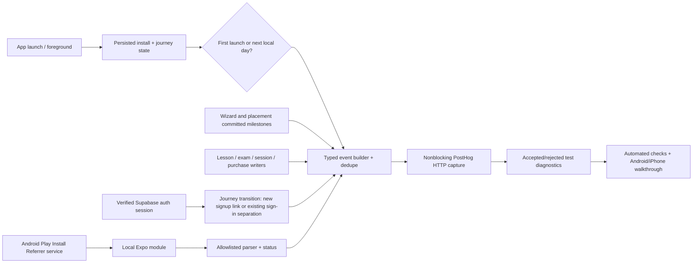

# Phase 9: Onboarding & Analytics Audit - Research

**Researched:** 2026-09-29
**Domain:** Expo 57 / React Native onboarding, PostHog HTTP capture, store attribution, device proof
**Confidence:** High for existing app seams and platform contracts; medium for the Android native bridge until a development build is compiled.

<user_constraints>
## User Constraints

The complete locked decisions D-01 through D-25 in [09-CONTEXT.md](09-CONTEXT.md) govern this phase. The approved [09-UI-SPEC.md](09-UI-SPEC.md) governs all touched screens. In particular: wizard completion is distinct from signup and placement; first lesson means content actually opened; interrupted placement resumes the same attempt; guest-to-new-account linkage happens only after successful signup; existing-account sign-in does not merge preceding guest events; raw referrer URLs and learner answers never enter analytics; user flows continue through telemetry failures; accepted capture and Android/iPhone device proof are release gates. Event names, fields, idempotency keys, attempt-abandonment rule, and test diagnostics remain implementation choices.
</user_constraints>

## Architectural Responsibility Map

| Capability | Owner | Secondary | Why |
|---|---|---|---|
| Wizard/placement recovery | Expo client persisted state | Supabase auth for verified session | Existing preferences/progress live on device; signup authority stays with auth. |
| Event schema, identity, deduplication, dispatch | `src/services/analytics.ts` and pure logic helpers | PostHog capture | Existing explicit HTTP transport is retained. |
| Install attribution | Android local native module + JS parser | Play Store service | The Play Install Referrer API is native and asynchronous. |
| iPhone campaign reporting | App Store Connect | App event records `unavailable` | Apple's campaign dashboard reports aggregate metrics, not an app-accessible per-install token. |
| Release proof | Node/Jest suites + development builds | PostHog test project and store sandbox | A local `track()` call alone cannot prove capture acceptance or real native flows. |

## Summary

The app already has a single nonblocking analytics seam, persisted Zustand stores, Supabase auth-session subscription, real placement grading, a lesson-completion writer, a session log, an exam result writer, and purchase events. Phase 9 should attach milestone events at those authoritative writes. It should not derive them from screen render, screen exit, or the existence of a button. Current analytics sends one POST to `/capture/` per event, does not inspect the response, and changes `distinct_id` from a stored anonymous ID to `userId` without linking identities. `app/onboarding.tsx` keeps its step in local state; `app/placement.tsx` keeps the shuffled question set and answers in local state. Both lose in-progress position on process death.

The existing Expo app is CNG-style (`app.json` plugins, no checked-in native directories). Android attribution therefore needs a local Android Expo module, the Play Install Referrer Client Library, a native development build, and a JS parser that allowlists `utm_source`, `utm_medium`, and `utm_campaign`. The client connection is asynchronous; first-open cannot wait for it. On iPhone, report `unavailable` in the app and inspect App Store Connect campaign results separately. A PostHog test project and observable HTTP response status/body are necessary to prove accepted capture while keeping the app flow nonblocking.

**Primary recommendation:** Build the event contract and identity/transport proof first; add recovery and milestone events at existing source-of-truth writes; finish with automated and two-platform device evidence.

## Standard Stack and source facts

| Tool | Existing or proposed | Use | Evidence |
|---|---|---|---|
| Expo SDK 57, RN 0.86.2 | Existing | App, AppState foreground subscription, local module | `ealch-v2/package.json`; [React Native AppState](https://reactnative.dev/docs/appstate) |
| Zustand persist + AsyncStorage | Existing | Wizard/placement checkpoint and install/journey metadata | `useStore.ts`, `useProgress.ts`, `analytics.ts` |
| Supabase Auth | Existing | Verified session boundary | `auth.ts`, `session.ts`; [Supabase email confirmation](https://supabase.com/docs/guides/auth/general-configuration) |
| PostHog HTTP capture | Existing | Typed event delivery and test capture diagnostics | `analytics.ts`; [PostHog persons and distinct IDs](https://posthog.com/docs/data/persons) |
| Play Install Referrer Client Library 2.2 | Proposed native dependency | Android install attribution | [Google Play library guide](https://developer.android.com/google/play/installreferrer/library) |
| Local Expo Android module | Proposed | Bridge Play client into JS in CNG builds | [Expo local modules](https://docs.expo.dev/more/create-expo-module/), [module integration](https://docs.expo.dev/modules/existing-library/) |
| Node test + jest-expo | Existing | Pure event/identity/date tests and screen route tests | `package.json`, `jest.config.js` |

## Architecture

### Placement checkpoint

Persist an attempt ID, selected question item IDs, option order, answer indices, current index, and status. Rehydrate that exact order; do not reshuffle on render or restart. Persist every answer before advancing. A normal background/process kill leaves status `in_progress`; explicit confirmed exit marks `abandoned`. This is the narrowest abandonment rule consistent with D-07 and avoids a timed false abandonment while the learner is away. Keep the first onboarding placement outcome immutable; later retakes use new attempt IDs.

### Identity and capture

Keep a per-install ID separate from the anonymous journey ID. `first_open` deduplicates by install. On guest signup, wait for an authenticated session before linking that specific guest journey to the new UID; do not merge on existing-account sign-in. On sign-out rotate the journey ID. The HTTP path must explicitly emit the supported PostHog identity operation and test its order/acceptance; merely switching `distinct_id` is insufficient. The exact `$identify`/`$alias` payload should be checked against the current PostHog ingestion contract during implementation and exercised against a disposable project to avoid accidental merging of shared-device users. Keep email and learner content out of event properties and diagnostic logs.

The test transport should record event name, event ID, allowed properties, response status, and response body acceptance marker in a configured test build. Failed/rejected capture is an observable QA failure, never a thrown user-flow exception. Do not claim a no-key build proves analytics. An HTTP 2xx response is the minimum transport acceptance check; if PostHog reports per-event rejection in its body or ingestion warnings, surface that in QA too.

### Attribution

Google's Play client returns a raw referrer string from the Play Store service; it also has unsupported/unavailable and transient failure response codes. Keep the raw value inside the parser, extract only recognized campaign fields, cap lengths, and return a status of `campaign`, `no_campaign`, `lookup_failed`, or `unavailable`. A sideloaded Android development build may show unavailable; a Play-delivered internal-test build is needed to prove campaign retrieval. The late `install_attribution` event shares the install ID with immediate `first_open`. Apple's App Store Connect campaign links have privacy thresholds and aggregate reporting; do not create learner-level attribution from the dashboard.

## Existing Integration Points and Pitfalls

| File | Current seam | Planning implication |
|---|---|---|
| `app/index.tsx`, `app/_layout.tsx` | Startup route and auth/session hooks | Start first-open only after install metadata hydration; AppState listener must avoid duplicate active events. |
| `app/onboarding.tsx`, `src/store/useStore.ts` | Step local state, persisted preferences, `finish()` writer | Persist last unfinished step and completion set; emit wizard-only completion at `finish()`, not generic `completeOnboarding`. Keep password out of persisted state. |
| `app/signin.tsx`, `src/services/session.ts`, `src/services/auth.ts` | Sign-in also calls `completeOnboarding`; `onAuthStateChange` is session authority | Distinguish new signup from existing-account sign-in. An accepted signup request with null session is not completed signup. |
| `app/den.tsx`, `src/components/TrailCard.tsx` | Optional placement offer, dismiss action | Record voluntary skip exactly at dismiss; do not count the later placement result as initial funnel outcome. |
| `app/placement.tsx`, `src/store/progress.logic.ts` | Real question set and grade; state local | Preserve exact question/answer state and attempt ID. Handle no-question Retry/Continue and explicit exit. |
| `app/lesson.tsx` | Paywall gate and `onQuizComplete`/`finish` | Count first lesson only after actual content is available; completion after existing session/progress write. |
| `app/exam-section.tsx` | Result writes before `setPhase('done')` | Emit `exam_submitted` after all section results are recorded, even with ungraded answers. |
| `src/store/useProgress.ts` | `logSession` stamps local day | Emit streak only for first qualifying session of that day, using updated streak length. |
| `app/paywall.tsx` | Purchase event exists after Adapty returns | Verify sandbox outcome and accepted capture; do not log raw error messages if they may contain sensitive content. |

Pitfalls: an unguarded `useEffect` duplicates events on rerender; `AsyncStorage` writes race if first-open and attribution start concurrently; local calendar days differ from rolling 24 hours; a locked lesson route can render a paywall before content; a cloned placement question may change answer option order; analytics `fetch` currently treats HTTP 400 as success; iOS development builds cannot prove App Store campaign counts; Expo Go cannot load a newly added native module.

## Validation Architecture

Use existing `npm test` for pure date, schema, identity, parser, idempotency, and placement checkpoint functions. Use `npm run test:component -- --runInBand` for wizard/placement action paths and route boundary assertions; `npm run typecheck` for event map/call-site parity. Use a local HTTP stub for rejected/accepted capture and a configured disposable PostHog project for real accepted capture. Gate first-open, signup, each onboarding step, placement skip/result/abandon, first lesson, lesson complete, exam submit, streak, purchase, and D1 with exact event counts/order, required IDs/outcomes, and forbidden answer/transcript/email fields. Prove no-key and rejected/offline analytics leave flows usable. Run guest and email wizard plus placement skip/result/abandon on both Android and iPhone; use a Play internal-test install for campaign attribution and store sandbox for purchase. A controlled-clock D1 unit test and a device foreground check satisfy D-14 without waiting a day. Record build IDs, OS, account kind, scenario, event IDs, endpoint responses, and failures in phase evidence; do not set Nyquist or phase verification to passing until these are observed.

## Open Risks

- Supabase may return an obfuscated/fake signup user for an existing confirmed email when confirmation is enabled. An accepted signup response alone does not prove a new account. Plan 01 requires a later authenticated session matching both the signup response user ID and a random `options.data.ealch_signup_nonce` before linking the guest journey; see [Supabase signup behavior](https://supabase.com/docs/reference/javascript/v1/auth-signup).
- The exact PostHog manual identity event payload and any alias restriction need an ingestion test before the identity plan is accepted. Do not silently rely on SDK behavior in an HTTP-only client.
- Android native bridge needs a development build and Play-delivered test to prove the source, separate from parser unit tests.
- iPhone physical build and sandbox purchase credentials may be unavailable during execution; this is a planned blocking evidence gate, not a reason to mark Phase 9 complete early.
- The current tree is dirty; executor should inspect each file before edits and stage only phase files.
